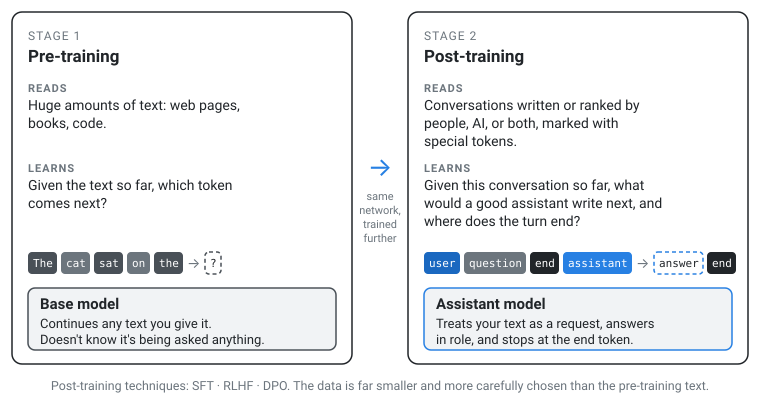

::: {.callout-tip .definition title="Definition"}
A base model is a language model that has only been through pre-training: it
has read an enormous amount of text and learned to continue it, one
[token](token.qmd) at a time. It has no built-in idea that you're asking it
something, or that it should stop once it's answered. Post-training is the
later stage that fills that gap, by training the same model further on
additional conversation data, written or ranked by people, AI, or a mix of
both, so it behaves more like a chat assistant than a base model does.
:::

Pre-training teaches a model to continue text. Post-training teaches it to
behave like an assistant.

## More context

### The big picture

Let's start with the whole journey in one image. Where does an assistant come
from? Not from a different kind of model, but from a second round of training
on top of the first.

{fig-alt="Two stages. Stage 1, pre-training: the model reads huge amounts of text and learns which token comes next, producing a base model that continues any text you give it. Stage 2, post-training: the same network is trained further on conversations written or ranked by people, AI, or both, marked with special tokens for user, assistant and end of turn, producing an assistant model that answers in role and stops at the end token. Techniques: SFT, RLHF, DPO."}

### What is a base model trained to do?

If nobody ever told a model to be helpful, what would it be good at? Exactly
one thing. Pre-training gives the model a single job: look at the tokens so far
and score every possible next token (that's [next-token
prediction](next-token-prediction.qmd)). Do that across a huge pile of text and
the model absorbs grammar, facts, writing styles, and some reasoning along the
way. But nothing in that job says "answer questions" or "be polite." It says
"make the text look like the text you've seen."

That's why a base model behaves like an auto-completer, and why there are
things it can't do the way an assistant can:

- **Treat your text as a request.** Your question is just the first part of a
  document, and the model continues the document. The continuation might be an
  answer, or another question, or a list of similar questions.
- **Stay in a role.** It has no concept of "you" and "me." There's no one it's
  supposed to be.
- **Know when it's finished.** Nothing in its training says that a reply should
  end after one answer, so it tends to keep going (more on this below).
- **Behave predictably.** You can't count on it to follow an instruction, hold a
  tone, or use a format you asked for, because "following instructions" was
  never the thing it was graded on.

### How does post-training turn it into an assistant?

If the model only continues text, how do you get a conversation out of it? You
show it what good conversations look like, over and over, until "continuing the
text" means "writing the assistant's next reply."

- **Collect conversations.** People write prompts and the replies they'd want,
  and later rank several replies the model itself produced. In the InstructGPT
  work, labelers wrote demonstrations of desired behavior for a set of prompts,
  including prompts submitted through the API, and ranked model outputs.
- **Train on them.** The job is still next-token prediction, but now the text it
  practices on is conversation, and the replies are the ones people preferred.
- **End up with the same network.** No new model is built. The base model's
  weights get adjusted, so what it already knows now comes out in an
  assistant's shape.

### How does the model know whose turn it is?

A conversation has speakers. A stream of tokens doesn't, so the training data
needs a way to mark "this part is the user" and "this part is the assistant."
The answer is special tokens: reserved entries in the
[tokenizer's](tokenizer.qmd) vocabulary that don't stand for ordinary text but
for structure. Here's the shape of one training example, written in a
ChatML-style format. This is an illustration I wrote to show the structure, not
output from a model.

```
<|im_start|>system
You are a helpful assistant.<|im_end|>
<|im_start|>user
What is the capital of France?<|im_end|>
<|im_start|>assistant
The capital of France is Paris.<|im_end|>
```

- **Role markers** say who is speaking. The `system` turn is the standing
  instructions for how to behave, `user` is you, and `assistant` is the model's
  turn.
- **The end token** closes a turn. It shows up at the end of every assistant
  reply in the training data, which matters for the next section.
- **The exact spelling varies.** Different model families use different
  markers. The idea, roles plus an end-of-turn signal, is what carries over.

Want to see it? Open [Tiktokenizer with `gpt-4o`
selected](https://tiktokenizer.vercel.app/?model=gpt-4o), type a short message
under a role, and look at the tokens around it. The role labels and end markers
appear as tokens of their own, just like words do.

And where can you look at real examples?

- **The InstructGPT paper.** [Training language models to follow instructions
  with human feedback](https://arxiv.org/abs/2203.02155) (Ouyang et al., 2022)
  describes how an assistant-style model was built from a pre-trained one. A
  pointer if you go looking: Section 3.4 is about how the labeler team was hired
  and managed. Example prompts are in Table 2 (Section 3.2) and in Appendix A,
  and the three training steps are described in Section 3.5.
- **OpenAssistant's `oasst1`.** [A public
  dataset](https://huggingface.co/datasets/OpenAssistant/oasst1) of
  human-written conversations. Each row is one message with a `role` of
  `prompter` or `assistant`, and replies are linked into trees, with some ranked
  against each other. At the time of writing it had about 88.8k rows across
  about 35 languages (read 2026-11-24).

### How is post-training done?

There isn't one recipe. Let's look at the three names you'll see most, at a
high level.

| Technique | Learns from | The idea |
|---|---|---|
| **SFT** (supervised fine-tuning) | Example conversations with the ideal assistant reply | Show it good answers and train it to write more like them. |
| **RLHF** (reinforcement learning from human feedback) | People ranking several answers to the same prompt | Use the rankings to build a scorer of what people prefer, then nudge the model toward answers that score higher. |
| **DPO** (direct preference optimization) | Pairs of answers: one preferred, one not | Uses the same kind of preference data as RLHF, but skips the separate scorer and the reinforcement-learning loop. It adjusts the model directly so the preferred answer becomes more likely than the other. |

: SFT, a reward-model scorer, and reinforcement learning are the three steps in [InstructGPT](https://arxiv.org/abs/2203.02155); DPO comes from [Rafailov et al. (2023)](https://arxiv.org/abs/2305.18290). Both read 2026-11-24.

Notice the pattern? SFT teaches by demonstration ("write it like this"). RLHF
and DPO teach by comparison ("this one is better than that one"). Judging two
answers is often easier than writing a perfect one from scratch, which is part
of why both kinds get used.

::: {.callout-note title="Simplified"}
This is the textbook version. Real pipelines vary in order, add more stages, and
don't only use human feedback: the DPO paper's introduction notes that the
feedback can come from AI too (RLAIF). Later entries can go into how each
technique works.
:::

### How does it learn when to stop?

A base model never has to decide that a reply is done, so what makes an
assistant stop? Look back at the training example above: every assistant turn
ends with the end token. That makes it just another next token to predict.
After a complete answer, the most likely next token is the end token, so the
model writes it, and the software running the model sees it and stops
generating.

- **Base model:** nothing teaches it that your question is a turn that should
  end after one answer. It tends to keep going, because there's always a next
  token, and the only hard stop is a length limit.
- **Assistant model:** stopping is something it was trained to do, over and
  over, in every example.
- **In the API:** that natural finish is what `stop_reason: end_turn` reports,
  and the length limit is `max_tokens`. Both are covered in [Context
  window](context-window.qmd).

### Chat app vs. API

You'll use the same assistant two different ways. In a chat app you go back and
forth, and in an API you send a request and expect something specific back.
What changes?

| | Chat app | API |
|---|---|---|
| **Typical use** | Back-and-forth: explore, refine, follow up. | One request, a defined result, often in a fixed format that your code reads. |
| **Who builds the conversation** | The app. It keeps your history and resends it each turn. | You. You assemble the list of messages for every request. |
| **Memory** | Feels like the model remembers. Really, the app resends everything. | Stateless: the API doesn't keep earlier turns, so each request must include the full history you want it to see. |
| **System prompt** | Set by the app. | Written by you. |
| **What comes back** | Prose you read. | Whatever you ask for: a label, a short answer, JSON. Check the stop reason before you trust it. |

: Stateless behavior and multi-turn structure: Anthropic's [Working with Messages](https://platform.claude.com/docs/en/build-with-claude/working-with-messages), read 2026-11-24.

So how do you feed the API the "full format"? Think of it as building the same
kind of conversation the model saw in post-training, with you as the author of
everything except the last reply.

- **Put standing rules in the system prompt.** The role, the output format, the
  limits.
- **Show examples as earlier turns.** You can add `user` and `assistant`
  messages that you wrote yourself, and the model treats them as a pattern to
  continue. The docs describe these synthetic assistant turns as a way to
  supply examples of the behavior you want.
- **End with the real request.** The last message is the new `user` turn, and
  the model writes the next `assistant` turn.
- **Use structured outputs when the format has to be exact.** Asking nicely
  works most of the time. A JSON schema is the way to make it hold every time
  (see the [structured outputs
  guide](https://platform.claude.com/docs/en/build-with-claude/structured-outputs)).
- **Validate what comes back.** Check `stop_reason`: `max_tokens` means the
  reply was cut off.

```json
{
  "model": "<model-id>",
  "max_tokens": 200,
  "system": "You label customer messages. Reply with one word: billing, bug, or other.",
  "messages": [
    {"role": "user",      "content": "I was charged twice this month."},
    {"role": "assistant", "content": "billing"},
    {"role": "user",      "content": "The export button does nothing."},
    {"role": "assistant", "content": "bug"},
    {"role": "user",      "content": "Can I change the email on my account?"}
  ]
}
```

A sketch of a request, not something I ran. Field names follow Anthropic's
Messages API; other providers differ (some put the system prompt inside the
messages list). The earlier turns are examples you wrote, and the model's job is
to write the next `assistant` message.

Behind the scenes, the provider turns that list into the model's own token
format, the special-token layout from earlier, before the model sees it. The
chat app and the API are two ways of building the same conversation. The app
builds it for you, and the API leaves it to you.

::: {.callout-note title="Older trick, now limited"}
You may read about "prefilling," where you start the assistant's reply yourself
and the model continues it. Anthropic's docs say it works on Claude 4.5 and
earlier models but returns an error on newer ones, which is why the list above
leans on examples, the system prompt, and structured outputs instead (read
2026-11-24).
:::

## Usage example

### See it for yourself

Let's watch one do it, next to the assistant it becomes. SmolLM2-360M is a
small, public base model, and SmolLM2-360M-Instruct is the same network after
post-training, so the only difference between them is the second stage. The
script below sends both the same question. For each one, it prints the model's
top five guesses for the very next token, then lets it keep going for up to 60
tokens and reports what stopped it. The base model gets the bare question. The
assistant gets it wrapped in its chat template, the way a chat app or API would
send it.

```python
import torch
from transformers import AutoModelForCausalLM, AutoTokenizer

PROMPT = "What is the capital of France?"
MAX_TOKENS = 60


def load(name):
    tok = AutoTokenizer.from_pretrained(name)
    model = AutoModelForCausalLM.from_pretrained(name).eval()
    return tok, model


def top5(tok, model, ids):
    """The model's five most likely next tokens, with probabilities."""
    with torch.no_grad():
        probs = model(ids).logits[0, -1].softmax(-1)
    top = torch.topk(probs, 5)
    return [(tok.decode(i), p.item()) for p, i in zip(top.values, top.indices)]


def generate(tok, model, ids, max_tokens=MAX_TOKENS):
    """Greedy loop: pick the top token, append it, repeat. Returns why it stopped."""
    end_tokens = {tok.eos_token_id, tok.convert_tokens_to_ids("<|im_end|>")}
    start = ids.shape[1]
    for _ in range(max_tokens):
        with torch.no_grad():
            next_id = model(ids).logits[0, -1].argmax().view(1, 1)
        ids = torch.cat([ids, next_id], dim=1)
        if next_id.item() in end_tokens:
            return tok.decode(ids[0, start:]), ids.shape[1] - start, "end token"
    return tok.decode(ids[0, start:]), max_tokens, "max_tokens"


def run(label, tok, model, text):
    ids = tok(text, return_tensors="pt", add_special_tokens=False).input_ids
    print(f"=== {label} ===")
    for t, p in top5(tok, model, ids):
        print(f"  {p:6.1%}  {t!r}")
    out, n, reason = generate(tok, model, ids)
    print(f"  output: {out!r}")
    print(f"  {n} tokens, stopped by: {reason}\n")


base_tok, base = load("HuggingFaceTB/SmolLM2-360M")
asst_tok, asst = load("HuggingFaceTB/SmolLM2-360M-Instruct")

# The chat template wraps the question in role markers and opens an
# assistant turn for the model to fill.
chat = asst_tok.apply_chat_template(
    [{"role": "user", "content": PROMPT}], tokenize=False, add_generation_prompt=True)

run("Base model, bare question", base_tok, base, PROMPT)
run("Assistant, chat template", asst_tok, asst, chat)
```

Here's what came back (recorded output, not reconstructed):

```
=== Base model, bare question ===
   67.6%  '\n'
   13.3%  '\n\n'
    1.8%  ' Paris'
    1.8%  '\n\n\n'
    1.6%  '\xa0'
  output: '\n\nParis, the capital of France, is the largest city in the country. It is the most populous city in Europe and the second-most populous city in the European Union.\n\nWhat is the capital of France?\n\nParis, the capital of France, is the largest city in'
  60 tokens, stopped by: max_tokens

=== Assistant, chat template ===
   31.2%  'The'
   21.5%  'I'
    5.1%  'As'
    4.8%  'You'
    3.7%  'Hello'
  output: 'The capital of France is Paris.<|im_end|>'
  8 tokens, stopped by: end token
```

Notice anything? Here's what to check:

- **Did it answer?** The base model's top guess for the next token is a newline
  (67.6%), not "Paris" (1.8%): it expects the document to keep going. Paris
  does show up, but inside an encyclopedia-style blurb, and the claim about
  Europe's most populous city is made up. The assistant's top guesses ("The",
  "I", "As") are the openings of a reply.
- **Did it stay on your question?** The base model repeats the question and
  starts the blurb over, the way a page of FAQ-style text might.
- **Did it stop?** The base model used all 60 tokens, so only the length limit
  stopped it. The assistant wrote 8 tokens and ended on `<|im_end|>`, the end
  token from the training example above.

The template also added a system prompt the script never wrote ("You are a
helpful AI assistant named SmolLM, trained by Hugging Face"), so the assistant
read 37 tokens where the base model read 7.

::: {.callout-note title="Base models aren't useless"}
You can get answers out of a base model by writing the beginning of a document
where an answer is the natural next part, for example a few question-and-answer
pairs followed by your new question. That works because it's still just
continuing text. The trick is that *you* do the work an assistant does for you
automatically.
:::

To try it yourself, read
[`base_vs_assistant.py`](https://github.com/bradleyboehmke/ai-engineering-notes/blob/main/learning/llm-mechanics/experiments/base_vs_assistant.py)
or [open the notebook in
Colab](https://colab.research.google.com/github/bradleyboehmke/ai-engineering-notes/blob/main/learning/llm-mechanics/experiments/base_vs_assistant.ipynb).
It runs on Colab's free CPU with no API key, and adds two runs that aren't
shown here: the base model answering when your question follows a few
question-and-answer pairs, and GPT-2, the base model from the earlier entries,
on the same question.

## What to avoid

- *"Fine-tuning teaches the model exactly what to respond with."* It shifts the
  model's tendencies. The training examples aren't stored as a lookup table, and
  the model still generates each reply token by token, so what you get is a
  likely answer, not a retrieved one.
- *"The assistant is a different kind of model."* It's the same network as the
  base model, trained further. The assistant starts from the base model's
  weights.
- *"Post-training is where the model learns what it knows."* Much of the model's
  knowledge comes from pre-training. Post-training mostly shapes how that
  ability gets used: the format, the tone, the role, when to stop.
- *"A base model can't answer questions."* It can, if the text you give it makes
  an answer the natural continuation. What it can't do is know that it should.
- *"The API remembers my earlier messages."* It doesn't. If a message isn't in
  the list you send, the model never sees it.

## Related terms

- **[Next-token prediction](next-token-prediction.qmd).** The one job
  pre-training gives the model, and the job post-training keeps using.
- **[Token](token.qmd).** The units the model reads and writes, including the
  special ones.
- **[Tokenizer](tokenizer.qmd).** Turns text into tokens, and holds the reserved
  entries for role and end markers.
- **[Context window](context-window.qmd).** The budget your whole conversation,
  history included, has to fit inside on every request.
- **Pre-training.** The first stage, where the model learns to continue text
  from a huge pile of it.
- **Special tokens.** Reserved tokens that mark structure, such as roles and the
  end of a turn.
- **Chat template.** The format that lays a conversation out as tokens before
  the model reads it.
- **System prompt.** The standing instructions at the start of a conversation.
- **SFT.** Supervised fine-tuning, which trains on example replies.
- **RLHF.** Reinforcement learning from human feedback, which trains toward
  answers people prefer.
- **DPO.** Direct preference optimization, a way to learn from preferences
  without a separate scorer.
- **Fine-tuning.** The general term for training a pre-trained model further.
  Post-training is the version done to turn a base model into an assistant.
- **Few-shot prompting.** Putting examples in the prompt so the model continues
  the pattern.
- **Structured outputs.** Constraining a reply to a format you define, such as a
  JSON schema.
- **Stop reason.** The API field that says why generation ended.

## Sources

- Terminal output from `base_vs_assistant.py`, recorded 2026-11-24 with
  `transformers` 5.23.0 and `torch` 2.15.0: SmolLM2-360M and
  SmolLM2-360M-Instruct, greedy decoding, `max_tokens=60`. The request sketch
  and the token-format illustration are written examples, not recorded output.
- [Ouyang et al., "Training language models to follow instructions with human feedback" (InstructGPT, 2022)](https://arxiv.org/abs/2203.02155):
  pipeline steps and section pointers, read 2026-11-24.
- [Rafailov et al., "Direct Preference Optimization" (2023)](https://arxiv.org/abs/2305.18290):
  DPO, and AI feedback (RLAIF), read 2026-11-24.
- [OpenAssistant, `oasst1`](https://huggingface.co/datasets/OpenAssistant/oasst1):
  row count, fields, and languages, read 2026-11-24.
- [Claude Platform Docs, "Working with Messages"](https://platform.claude.com/docs/en/build-with-claude/working-with-messages):
  stateless API, example turns, and prefill support, read 2026-11-24.
- [SmolLM2-360M-Instruct model card](https://huggingface.co/HuggingFaceTB/SmolLM2-360M-Instruct):
  the base model it was post-trained from (SFT, then DPO).
- [Tiktokenizer](https://tiktokenizer.vercel.app/?model=gpt-4o): special tokens
  in a chat format.
