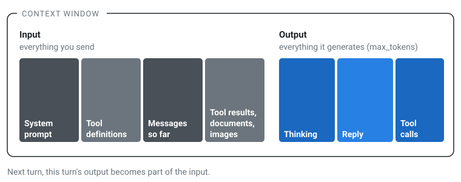

::: {.callout-tip .definition title="Definition"}
The context window is the cap on how many tokens a single request can use in
total: everything the model is given (instructions, conversation, tools, files,
images) plus everything it writes back, reasoning included. The limit is fixed
per model, and input and output share it. A bigger window raises the cap but
doesn't make a fuller request a better one.
:::

## More context

### What counts toward the window?

Let's start with a question: when you hit send, what actually lands in the
window? More than your message.

{fig-alt="The context window holds input (system prompt, tool definitions, messages so far, tool results and documents and images) and output (thinking, reply, tool calls). On the next turn, this turn's output becomes part of the input."}

- **Input: what you send.** The system prompt, every message in the
  conversation so far, tool definitions, images, and documents. The longer a
  conversation runs, the more of the window the input takes up before the model
  writes a word.
- **External context: what tools bring in.** When a tool call returns something
  (a search result, a file, a database row), that result is added to the
  conversation and counts as input on the next call. You didn't type it, but it
  takes up the same room.
- **Output: what the model generates.** The reply, any tool calls, and any
  thinking. Thinking tokens are part of your `max_tokens` budget, not an extra on
  top of it, and they count toward the window.
- **Thinking can stick around.** On recent models (Claude Opus 4.5 and later,
  Sonnet 4.6 and later, Haiku 5.5, and the Fable models), earlier thinking blocks
  are kept by default and count as input on later turns. Older models drop them
  automatically.
- **Caching doesn't shrink it.** Prompt caching changes what you pay, not
  whether the tokens occupy the window.

### How big is it?

It depends on the model, so here's what Anthropic and OpenAI list today. "Max
output" is the most you can set `max_tokens` to.

| Model | API ID | Context window | Max output |
|---|---|---:|---:|
| Claude Opus 5.5 | `claude-opus-5-5` | 1M | 128K |
| Claude Sonnet 5.5 | `claude-sonnet-5-5` | 1M | 128K |
| Claude Haiku 5.5 | `claude-haiku-5-5` | 1M | 128K |
| Claude Fable 5.2 | `claude-fable-5-2` | 1M | 128K |
| Claude Haiku 4.5 | `claude-haiku-4-5` | 200K | 64K |
| GPT-6.1 Sol | `gpt-6.1-sol` | 1.05M | 128K |
| GPT-6.1 Terra | `gpt-6.1-terra` | 1.05M | 128K |
| GPT-6 Astra | `gpt-6-astra` | 1.05M | 128K |
| GPT-6 Luna | `gpt-6-luna` | 1.05M | 128K |

: Read from [Anthropic's models overview](https://platform.claude.com/docs/en/models/overview) on 2026-11-18 and [OpenAI's models page](https://developers.openai.com/api/docs/models) on 2026-11-16. Limits change with new models, so check the page before you plan around a number.

On OpenAI, the output cap is called `max_output_tokens`, and a reply cut off by
it comes back with `status: "incomplete"` instead of a stop reason.

### Budget a request

Here's the rule of thumb: your input plus `max_tokens` should fit inside the
window. Change the numbers below and watch which of three outcomes you land in.

```{=html}
<link rel="stylesheet" href="widgets/context-budget.css">
<div class="context-budget"></div>
<script src="widgets/context-budget.js"></script>
```

- **Count before you send.** The token counting API gives you an estimate of the
  input. The docs call it an estimate, and the count and the billed usage aren't
  always identical, so leave a margin.
- **Reserve output room on purpose.** Output needs room of its own. Set
  `max_tokens` to what the task needs, thinking included, not to whatever happens
  to be left over.
- **Leave the rest empty.** Unused window isn't waste. It's the part of the
  budget you didn't have to spend.

::: {.callout-note title="Simplified"}
The widget adds up a request's footprint as input plus `max_tokens` and shows
the behavior of Claude 4.5 and newer models, which accept a request when input
fits but input plus `max_tokens` doesn't. Earlier models reject that combination
with a validation error. Real replies usually stop well before `max_tokens`, so
the output room is a ceiling, not a prediction.
:::

### Bigger isn't the goal

If the window is 1M tokens, why not use all of it? Because fitting is only the
minimum bar.

- **Accuracy and recall degrade as tokens pile up.** Anthropic's docs call this
  context rot, and their advice is to curate what's in context rather than
  maximize it ([context windows
  docs](https://platform.claude.com/docs/en/build-with-claude/context-windows),
  read 2026-11-18).
- **The middle gets less attention.** Models tend to lean on the start and end
  of a long context and lose detail in the middle, so even a large window can
  fail to retrieve something it technically contains ([Liu et al.,
  2024](https://arxiv.org/abs/2307.03172), which tested 2023-era models).
- **There's no published safe line.** The docs don't give a fill level where
  quality starts to slip, so the only honest answer is to test your own task at
  different sizes.
- **Stay lean on purpose.** The docs point to compaction (summarizing earlier
  conversation), clearing old tool results and thinking blocks, and deferring
  tool definitions until they're needed.

::: {.callout-note title="My take"}
A bigger window changes what *fits*, not what's *worth including*. I don't want
to ask "will it fit?" I want to ask "what's the smallest context that still
gives the model what it needs?"
:::

## Usage example

### Two ways a request ends

Let's run it. Here's what came back from a small script that calls the API
three ways (recorded output, not reconstructed). The first two runs send the
same prompt to `claude-haiku-5-5`: *"In about 150 words, explain how to clean a
messy sales dataset in Python."* Thinking is switched off, so `max_tokens` only
has to cover the reply. The third run sends a deliberately oversized prompt to
`claude-haiku-4-5`, which has a smaller window and is cheaper to overflow.

```
$ python learning/llm-mechanics/experiments/limits_api.py --overflow

count_tokens: 33 input tokens

max_tokens=30
   stop_reason:   max_tokens
   input_tokens:  31
   output_tokens: 30
   ends with:     'a messy sales dataset in Python usually starts with pandas. First, load the data'

max_tokens=1024
   stop_reason:   end_turn
   input_tokens:  31
   output_tokens: 425
   ends with:     'te your work by re-running `df.info()` and saving the result with `df.to_csv()`.'

claude-haiku-4-5 context window: 200,000 tokens
count_tokens:  210,008 input tokens (over by design)
   HTTP 400: prompt is too long: 210031 tokens > 200000 maximum
```

The runs fall into two buckets:

- **Responses that come back (HTTP 200).** You check `stop_reason`, which can be
  `end_turn`, `max_tokens`, or `model_context_window_exceeded`.
  - *Cut off* (`stop_reason: max_tokens`). The output used all 30 of its 30
    allowed tokens, so the reply stops mid-thought. This isn't an error: you get
    a normal response that's just truncated.
  - *Finished on its own* (`stop_reason: end_turn`). Same kind of request with
    `max_tokens=1024`. The model used 425 tokens and stopped because it was done,
    not because it hit the ceiling.
- **Requests that never get a response (HTTP 400).** The SDK raises an
  exception, so you handle it with `try`/`except`. The script padded the prompt
  with repeated filler until it was about 5% over the 200,000-token window. The
  input alone was 210,031 tokens, so the API rejected the request with
  `invalid_request_error` and nothing was generated, even though `max_tokens` was
  only 30. The script's separate `RateLimitError` branch shows that a 429 lands
  in this bucket too, but it calls for a different fix: a 400 means fix the
  request, while a 429 means wait and retry.

Notice anything? In the second run, `max_tokens` was 1,024 and the reply was 425.
The setting is a ceiling, not a target length. Look at the counts too:
`count_tokens` estimated 33 input tokens, while the API reported 31 for the real
calls. The count and the billed usage aren't identical. (The overflow pair,
210,008 versus 210,031, differs for a simpler reason: the count measured the
filler alone, and the real request also appended "Summarize the above.")

| What happens | What you see |
|---|---|
| Output reaches `max_tokens` | `stop_reason: max_tokens`, reply truncated |
| Model finishes | `stop_reason: end_turn` |
| Input alone is over the window | HTTP 400, `invalid_request_error`, "prompt is too long" |
| Input fits, but output runs into the window | `stop_reason: model_context_window_exceeded` (Claude 4.5 and newer) |

::: {.callout-note title="A fourth ending"}
The last row is a case the script above didn't hit. It happens when input plus
`max_tokens` is over the window but the input alone fits: the request is
accepted, and generation can end when it reaches the window limit.
:::

To try it yourself, read
[`limits_api.py`](https://github.com/bradleyboehmke/ai-engineering-notes/blob/main/learning/llm-mechanics/experiments/limits_api.py)
or [open the notebook in
Colab](https://colab.research.google.com/github/bradleyboehmke/ai-engineering-notes/blob/main/learning/llm-mechanics/experiments/context_limits.ipynb).
You'll need your own Anthropic API key, and the notebook shows how to add it
without pasting it into a cell.

## What to avoid

- *"The context window is how much I can send."* It covers the model's output
  too, thinking included, so your input and the reply share one budget.
- *"`max_tokens` is how long the reply will be."* It's a cap. The run above
  asked for up to 1,024 and got 425.
- *"Cached tokens don't count toward the window."* They still occupy it. Caching
  affects cost, not capacity.
- *"Thinking doesn't count."* Thinking tokens count toward the window and come
  out of your `max_tokens` budget.
- *"A 1M window means I can use 1M tokens well."* Fitting and performing well are
  different things, and quality tends to drop as the window fills.

## Related terms

- **[Token](token.qmd).** The unit the window is measured in.
- **[Tokenizer](tokenizer.qmd).** What turns your text into tokens, and why the
  same text can cost different amounts on different models.
- **[Next-token prediction](next-token-prediction.qmd).** Why output grows one
  token at a time and every new token adds to the window.
- **max_tokens.** The ceiling you set on how many tokens the model can generate
  in one response.
- **Stop reason.** The field that tells you why generation ended.
- **Context rot.** The drop in accuracy and recall as the number of tokens in
  context grows.
- **Compaction.** Summarizing earlier conversation so a long task can continue
  within the window.
- **Thinking.** The model's reasoning tokens, which count toward both
  `max_tokens` and the window.
- **Prompt caching.** Reusing a repeated prefix at lower cost; the cached tokens
  still count toward the window.
- **Token counting.** An API call that estimates input tokens before you send the
  request.

## Sources

- Terminal output from `limits_api.py --overflow` against the Anthropic API,
  recorded 2026-11-18. The first two runs used `claude-haiku-5-5` with thinking
  disabled and `max_tokens` of 30 and 1024. The overflow run used
  `claude-haiku-4-5`, with the 200,000-token window read from the Models API,
  `max_tokens=30`, and a prompt about 5% over the window.
- [Claude Platform Docs, "Models overview"](https://platform.claude.com/docs/en/models/overview):
  window sizes and max output, read 2026-11-18.
- [OpenAI, "Models"](https://developers.openai.com/api/docs/models): window
  sizes and max output, read 2026-11-16.
- [OpenAI, "Reasoning models"](https://developers.openai.com/api/docs/guides/reasoning):
  `max_output_tokens` and `status: "incomplete"`.
- [Claude Platform Docs, "Context windows"](https://platform.claude.com/docs/en/build-with-claude/context-windows):
  behavior of input, output, thinking, caching, context rot, and overflow, read
  2026-11-18.
- [Liu et al., "Lost in the Middle: How Language Models Use Long Contexts" (TACL 2024)](https://arxiv.org/abs/2307.03172):
  less attention to the middle of a long context.
- [AI Hero, "What is the context window?"](https://www.aihero.dev/what-is-the-context-window):
  framing of what fills the window, read 2026-11-18.
