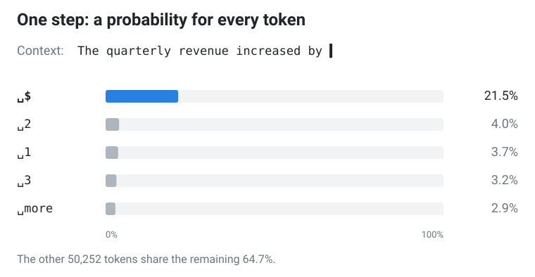
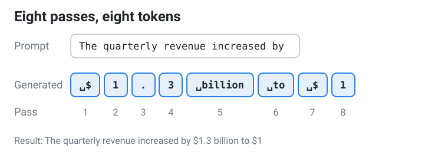

::: {.callout-tip .definition title="Definition"}
Next-token prediction is the one thing an LLM does at inference time: it reads a
sequence of tokens and outputs a probability for every token in its vocabulary,
where each probability says how likely that token is to come next. The model
doesn't output a word, a sentence or even a single chosen token. Text appears
because a loop around the model chooses one token from those probabilities, adds
it to the end of the sequence and runs the model again.
:::

## More context

Next-token prediction is also the name of the pretraining objective, where the
model is scored with cross-entropy on the token that actually came next in the
training text, but this page covers inference, which is what happens when you
run the trained model.

### What the model actually outputs

Let's start with a single step, because everything else is that step repeated.
You give the model a sequence of [tokens](token.qmd), which we'll call the
context. The model gives back one raw score for every token in its vocabulary.
GPT-2, the small open model used throughout this doc, has a vocabulary of 50,257
tokens, so a single step produces 50,257 scores.

Raw scores are hard to read. They can be any number, positive or negative, and
they don't add up to anything in particular. So the scores go through a function
called softmax, which rescales them into probabilities. Every value lands between
0% and 100%, the whole list adds up to 100%, and a higher score always gets a
bigger share. You don't need the formula. All you need to know is that softmax
turns a list of scores into a list of chances.

Here's what that looks like when you give GPT-2 the context "The quarterly
revenue increased by".

{fig-alt="GPT-2's top five next-token probabilities after The quarterly revenue increased by: space-dollar 21.5%, space-2 4.0%, space-1 3.7%, space-3 3.2%, space-more 2.9%. The other 50,252 tokens share the remaining 64.7%."}

Notice two things. First, the model didn't answer with "\$". It answered with all
50,257 probabilities, and we're only looking at the top five. Second, the leader
is far from a sure thing. The top token has 21.5%, the top five together add up
to 35.3%, and the rest is spread thinly across tens of thousands of other tokens.

### The probabilities are for tokens, not text

Here's the detail that's easy to miss. The model never outputs characters. Its
output is a list of numbers, and each position in that list lines up with one
token ID in the vocabulary. So when we say `␣$` has a 21.5% chance, what the
model really gave us is "the token ID at this position has a probability of
0.215".

To read that as text, we hand the ID to the [tokenizer](tokenizer.qmd), which
converts it back to its character or characters. It's the same tokenizer that
turned your prompt into token IDs, running in reverse.

That's also why the candidates above look like tokens and not like words. `␣$`
carries its leading space. And as you'll see in the next section, "billion"
arrives in one step while "1.3" takes three: `1`, then `.`, then `3`.

### How one prediction becomes a paragraph

So how do you get from one list of probabilities to a full reply? You run the
same step in a loop. Each pass through the loop does four things:

1. **Score.** Using every token in the context, the model gives each token in its
   vocabulary a raw score.
2. **Convert.** Softmax turns those scores into probabilities.
3. **Choose.** One token is selected from the probabilities. In this doc we always
   take the one with the highest probability.
4. **Append.** The chosen token is added to the end of the context, and the loop
   starts over with a context that's one token longer.

Each pass adds exactly one token, and that token becomes part of the input for
every pass after it.

Let's watch it run. Here are eight passes of the loop, starting from the same
context as before.

| Step | Chosen token | Probability | Runner-up | Probability |
|---:|---|---:|---|---:|
| 1 | `␣$` | 21.5% | `␣2` | 4.0% |
| 2 | `1` | 11.6% | `2` | 6.5% |
| 3 | `.` | 87.1% | `␣million` | 5.6% |
| 4 | `3` | 10.5% | `4` | 9.8% |
| 5 | `␣billion` | 65.1% | `␣million` | 31.7% |
| 6 | `␣to` | 27.6% | `,` | 19.1% |
| 7 | `␣$` | 89.3% | `␣reach` | 0.8% |
| 8 | `1` | 10.8% | `2` | 6.0% |

: GPT-2, eight passes of the loop, always choosing the top token.

{fig-alt="The prompt The quarterly revenue increased by, followed by eight generated tokens, one per pass: space-dollar, 1, period, 3, space-billion, space-to, space-dollar, 1."}

Eight passes gave us eight tokens. Keep the loop going and you get a sentence,
then a paragraph. It stops when the chosen token is a special end-of-text token,
or when it hits a limit you set. Here it stopped because we asked for eight
steps.

Look at step 5. "billion" gets 65.1%, but only because "\$1.3" is already sitting
in the context. And "\$1.3" is there because of step 4, where `3` beat `4` by
less than a percentage point. With greedy decoding or sampling, the loop never
goes back to reconsider a token. Once a token is appended, everything after it is
built on top of it.

::: {.callout-note title="This is \"greedy\" next-token prediction"}
Everything in this doc picks the token with the highest probability at every
step. That rule is called greedy decoding, and it's the simplest way to choose.
It's not how LLMs usually run in practice. Most of the time they apply sampling,
which means the next token is drawn at random in proportion to the probabilities,
so the top token doesn't always win. That's one reason the same prompt can give
you different replies. We'll cover sampling in a later write-up. For now, keep
the two jobs separate: the model produces the probabilities, and a rule outside
the model does the choosing.
:::

### Why the loop matters for latency and cost

Why should you care how the loop works? Because it tells you where the time goes,
and it keeps you from misreading the bill.

Let's start with latency. The model doesn't handle your prompt and its reply the
same way. It reads the whole prompt in one parallel pass, but it writes the reply
one token at a time, with one pass per token
([NVIDIA](https://developer.nvidia.com/blog/mastering-llm-techniques-inference-optimization/)
calls these the prefill and decode phases). So a longer reply takes longer. When
you estimate how long a request will take, the expected length of the output
usually matters more than the size of the prompt.

Cost is a different story. You're billed per token, not per pass, so the number
of passes isn't what drives the bill. What matters is that providers price output
tokens higher than input tokens. For example, Claude Sonnet 5.5 is listed at \$2
per million input tokens and \$10 per million output tokens, which makes an
output token five times the price of an input token
([Claude pricing](https://platform.claude.com/docs/en/about-claude/pricing), read
2026-11-16).

Put the two together and a verbose reply costs you twice: once in waiting time
and once on the bill.

## Usage example

Let's make this concrete. The loop takes about ten lines of Python. This is the
core of
[`step.py`](https://github.com/bradleyboehmke/ai-engineering-notes/blob/main/learning/llm-mechanics/experiments/step.py),
which loads GPT-2 and steps through the loop one token at a time.

```python
ids = tok(prompt, return_tensors="pt").input_ids

for step in range(1, steps + 1):
    with torch.no_grad():
        logits = model(ids).logits[0, -1]       # one score per vocabulary token
    probs = torch.softmax(logits, dim=-1)        # scores -> probability distribution
    top = torch.topk(probs, 5)

    for p, i in zip(top.values, top.indices):
        print(f"   {p.item():6.1%}  {tok.decode(i)!r}")

    next_id = top.indices[:1].view(1, 1)        # greedy: take the most likely
    ids = torch.cat([ids, next_id], dim=1)      # append, then loop
    if next_id.item() == tok.eos_token_id:
        break
```

There are only five pieces you need to understand:

- `tok(prompt, ...)` turns your prompt into token IDs. From here on, the model
  only works with IDs.
- `model(ids).logits[0, -1]` runs the model once and keeps the raw scores for
  what comes after the last token. That's one score for each of the 50,257
  tokens.
- `torch.softmax(logits, dim=-1)` converts the scores into probabilities.
- `torch.topk(probs, 5)` finds the five highest probabilities and the token IDs
  they belong to. `tok.decode(i)` is the tokenizer turning each ID back into text
  so you can read it.
- `top.indices[:1]` takes the top token (the greedy choice), and `torch.cat`
  appends it to the context. Then the loop runs again. It ends early if the
  chosen token is the end-of-text token.

You can run it on any prompt and any number of steps:

```text
$ python step.py "The quarterly revenue increased by" 8
```

That command produced every probability in the walkthrough above, and it ends
with this line:

```text
Result: 'The quarterly revenue increased by $1.3 billion to $1'
```

Notice anything? The model wrote "\$1.3 billion", and nothing in the prompt says
that. There's no revenue figure anywhere for it to find. `1` was chosen at 11.6%
and `3` at 10.5%, simply because they were the most likely digits at that point
in the text.

Every probability in this doc comes from running `step.py` on GPT-2 (the
124M-parameter model, 50,257-token vocabulary) with greedy decoding on
2026-11-15. Other models will give different probabilities and different text.

To run this yourself, with the sample prompt or your own text,
[open the notebook in Colab](https://colab.research.google.com/github/bradleyboehmke/ai-engineering-notes/blob/main/learning/llm-mechanics/experiments/step_tokens.ipynb).
It shows the top 10 next tokens for any text, runs the loop for as many tokens
as you ask for, and maps the path the loop took, step by step.

## What to avoid

If you drop only one phrase from your vocabulary, make it this one: **"the model
looks things up."** There's no lookup step anywhere in the loop. The model scores
tokens, and that's all it does. "\$1.3 billion" didn't come from a database or a
remembered document. It came from two digit tokens that each had about a one in
ten chance. Ask a model for a figure and it will always give you a
plausible-looking one, so if the true value matters, it has to be in the
context.

A few other phrases are close to right but will still lead you astray.

- **"The model predicts the next word."** It works in tokens, not words, and it
  outputs a probability for every token in the vocabulary, not a single answer.
- **"The model picks the most likely token."** The model doesn't pick anything. A
  rule outside the model does, and greedy is only one such rule. With sampling,
  the most likely token often loses.
- **"The model plans its answer."** Use this one with care. The loop itself has
  no outline and no draft, and it can't go back to revise a token. But what
  happens inside a single pass is a separate question. Anthropic researchers
  studying rhyming poetry
  [expected to find no planning ahead and found that the model did plan](https://www.anthropic.com/research/tracing-thoughts-language-model).
  So the safe thing to say is that the output is committed one token at a time,
  not that the model can't think ahead.
- **"It's just autocomplete."** The mechanism is as simple as this doc makes it
  look. That doesn't mean the scoring is simple. All of the model's capability
  lives in how it arrives at those 50,257 scores.

## Related terms

Next-token prediction connects tokens to almost everything that comes later.
These are the ones worth learning next, and the ones to link from this entry in
the dictionary.

- **[Token](token.qmd).** The unit the model reads and writes. Every probability
  here belongs to one token.
- **[Tokenizer](tokenizer.qmd).** The component that converts text to token IDs
  on the way in, and token IDs back to text on the way out.
- **Vocabulary.** The fixed list of every token a model knows. It's also the list
  the model scores at every step.
- **Logit.** The raw score the model gives a token before softmax.
- **Softmax.** The function that turns raw scores into probabilities that add up
  to 100%.
- **Greedy decoding.** Always choosing the token with the highest probability.
- **Sampling.** Choosing the next token at random in proportion to the
  probabilities. Temperature, top-k and top-p are the settings that shape it.
- **Autoregressive generation.** The formal name for the loop, where each output
  becomes part of the next input.
- **End-of-text token.** The special token that tells the loop to stop.
- **Context window.** The maximum number of tokens the model can read at once,
  including the ones it has generated so far.
- **Hallucination.** A fluent, plausible output that isn't true. For example,
  given "Revenue was \$40 million in Q1 and \$46 million in Q2. From Q1 to Q2,
  quarterly revenue increased by \$", GPT-2 had both figures it needed for the
  true answer of \$6 million in its context, and it still wrote "1.3".

## Sources

- [Hugging Face Transformers, "Text generation"](https://huggingface.co/docs/transformers/llm_tutorial):
  the loop over the model's own outputs, the end-of-sequence token, and length
  limits.
- [Hugging Face, "How to generate text"](https://huggingface.co/blog/how-to-generate):
  autoregressive generation and greedy search, with GPT-2.
- [Andrej Karpathy, "Deep Dive into LLMs like ChatGPT"](https://www.youtube.com/watch?v=7xTGNNLPyMI):
  the pretraining and inference sections.
- [Anthropic, "Tracing the thoughts of a large language model"](https://www.anthropic.com/research/tracing-thoughts-language-model):
  planning ahead within a pass.
- [NVIDIA, "Mastering LLM Techniques: Inference Optimization"](https://developer.nvidia.com/blog/mastering-llm-techniques-inference-optimization/):
  the prompt is processed in parallel (prefill) and output is generated one token
  at a time (decode).
- [Claude Platform Docs, "Pricing"](https://platform.claude.com/docs/en/about-claude/pricing):
  input and output token prices, read 2026-11-16.
