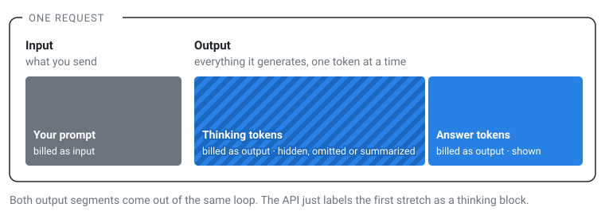

::: {.callout-tip .definition title="Definition"}
A reasoning model is a language model that was post-trained to write out
intermediate steps, such as checking numbers or trying an approach, as
**thinking tokens** before it writes the answer you asked for. It runs the same
loop as any other model, one [token](token.qmd) at a time with each new token
built on everything before it, so those steps become context that the answer is
built on. You're billed for those thinking tokens as output, even when the API
hides them.
:::

A model post-trained to write out its intermediate steps before it answers, and
billed for every token of those steps whether you see them or not.

## More context

### What's different about the loop?

Let's start with what changes when a model "reasons." Here's the whole request,
laid out as the model produces it.

{fig-alt="Within one request, the input is followed by thinking tokens and then answer tokens. Thinking tokens are billed as output and are hidden, omitted or summarized. Answer tokens are billed as output and are shown."}

- **The loop is the same.** The model scores every possible next token, one gets
  picked and appended, and the loop repeats (that's
  [next-token prediction](next-token-prediction.qmd)). A reasoning model doesn't
  add a second mechanism. It runs that loop for longer before the answer starts.
- **The extra tokens become context.** Every new token is built on all the tokens
  already written. If the model writes down "B converts better on mobile" early
  on, every later token can lean on that line. A model that answers in one pass
  has no scratch work to lean on.
- **What the intermediate steps contain.** Anthropic's docs describe them as
  restating the question, trying approaches, checking intermediate results, and
  dropping paths that fail before the answer is written (read 2026-11-26).

### Is it a different kind of model?

Where does a reasoning model come from? Not from a new architecture. It comes
from the same place an assistant does, which is more training on top of a
pre-trained network. The [Base model & post-training](base-model.qmd) entry
covers the first two rows below. The third row is the new part.

| Stage | The model learns to | You get |
|---|---|---|
| **Pre-training** | Continue text, one token at a time | A base model |
| **Post-training** (SFT, RLHF, DPO) | Answer in a role and stop at the end token | An assistant |
| **More post-training**, with reinforcement learning | Write out intermediate steps before answering, because answers reached that way tend to score as correct | A reasoning model |

Reinforcement learning means generating attempts and rewarding the good ones.
The DeepSeek-R1 paper reports that reasoning ability can be developed this way
without human-labeled reasoning examples, and that behaviors like
self-reflection and verification emerged along the way
([arXiv 2501.12948](https://arxiv.org/abs/2501.12948), read 2026-11-26).

::: {.callout-note title="Simplified"}
This is the textbook ladder. Real pipelines mix these stages, and the
"reasoning model" label is blurring. You can choose between different models,
but you generally can't choose whether a model reasons. On Claude 5 models
thinking is on without any configuration, and the model decides on each request
whether to think and how long
([Anthropic, Thinking](https://platform.claude.com/docs/en/build-with-claude/thinking),
read 2026-11-26). My view is that most current flagship models work this way, so
what you control is how much they reason, through effort (covered below). Some
let you turn thinking off: Haiku 5.5 accepts `thinking: {"type": "disabled"}` at
`high` effort or below, and Sonnet 5.5 rejects `disabled` but accepts
`thinking: {"type": "between_tools"}` at `high` effort or below, which turns off
up-front thinking. Opus 5.5 is the one where thinking is always on.
:::

### What does it cost, and where do you see it?

This is the part to take with you. Look at what you're billed for and what
you're shown, because they aren't the same.

::: {.callout-note title="The cost fact"}
Thinking tokens are billed as output tokens, at the output price, whether or not
the response shows them. The bill follows `output_tokens`, not the length of the
text you read.
:::

| | Anthropic (Claude) | OpenAI |
|---|---|---|
| **Billed as** | Output tokens | Output tokens |
| **The usage field that proves it** | `usage.output_tokens_details.thinking_tokens`, a part of `usage.output_tokens` | `usage.output_tokens_details.reasoning_tokens`, a part of the output total |
| **What you see** | On Claude 5 models, `display` defaults to `"omitted"`, which gives an empty thinking block. `"summarized"` gives a summary written by a different model. | Raw reasoning is never returned. A summary is opt-in through the `reasoning` parameter. |
| **The control** | `output_config.effort` | `reasoning.effort` |
| **Counts toward the output cap** | Yes, `max_tokens` | Yes, `max_output_tokens`. The guide suggests reserving at least 25,000 tokens when you start. |

: Anthropic: [Steering thinking](https://platform.claude.com/docs/en/build-with-claude/thinking-steering-and-cost) and [Thinking](https://platform.claude.com/docs/en/build-with-claude/thinking). OpenAI: [Reasoning models](https://developers.openai.com/api/docs/guides/reasoning). All read 2026-11-26.

- **How to read the field.** `output_tokens` is the inclusive total you're
  billed for. The thinking field is a breakdown inside it, so
  `output_tokens - thinking_tokens` approximates the part you can read.
  Anthropic's docs say the field counts the raw reasoning, not the summary text.
- **Hiding it doesn't discount it.** `display: "omitted"` saves latency. The full
  thinking is billed either way, and summary generation isn't charged on top.
- **It can eat your cap.** Thinking comes first and shares `max_tokens` with the
  answer, and Anthropic enforces that cap strictly. A cap sized for the visible
  answer alone can run out while the model is still thinking, and the thinking
  tokens are billed either way. OpenAI's guide says that when the limit is
  reached the response is marked incomplete and may contain no visible output.
  That's why the script below sets `max_tokens=8000` and prints the stop reason
  when it isn't `end_turn`. [Context window](context-window.qmd) shows how a
  request ends at `max_tokens`.
- **It can come back as input.** On models that keep earlier thinking blocks in
  context, those blocks are billed as input on later turns. They also take up
  room in the [context window](context-window.qmd).

### Thinking tokens or reasoning tokens?

Are those two terms for two different things? No. They're two providers' names
for the same thing: tokens the model generated while working toward the answer,
billed as output. Anthropic's field is `thinking_tokens` and OpenAI's is
`reasoning_tokens`. This dictionary uses **thinking tokens** as the main term,
because the examples run on Claude, and treats **reasoning tokens** as the
alias. Neither provider treats them as a separate price category. They're output
tokens that you may not get to read.

### What is effort?

If you can't always switch thinking off, what do you turn? **Effort** is a
setting that tells the model how much to think, and how much to spend on the
answer overall. Anthropic's levels are `low`, `medium`, `high`, `xhigh` and
`max`. OpenAI's `reasoning.effort` takes values from `none` up to `max`, and
which ones work depends on the model.

- **It's a signal, not a budget.** Anthropic's docs call it "a behavioral signal,
  not a strict token budget." At lower effort Claude still thinks on hard
  problems, just less.
- **Defaults differ by model.** Haiku 5.5 and Opus 5.5 default to `medium`.
  Sonnet 5.5 defaults to `high`
  ([Anthropic, Effort](https://platform.claude.com/docs/en/build-with-claude/effort),
  read 2026-11-26). Leaving effort unset means a model change can quietly change
  your bill.
- **Choosing a level is a model-selection question.** That gets its own entry
  later. Here, effort is the thing the usage field lets you measure.

::: {.callout-note title="You can't always turn it off"}
On Claude Opus 5.5, thinking is always on. A request with
`thinking: {"type": "disabled"}` returns a 400 error at every effort level, so
effort is the only dial you have there. It varies by model. Sonnet 5.5 rejects
`disabled` but accepts `thinking: {"type": "between_tools"}` at `high` effort or
below, which turns off up-front thinking, and Haiku 5.5 accepts `disabled` at
`high` effort or below
([Anthropic, Effort](https://platform.claude.com/docs/en/build-with-claude/effort)
and [Thinking](https://platform.claude.com/docs/en/build-with-claude/thinking),
read 2026-11-26).
:::

## Usage example

### See it for yourself

Let's measure it. The script `thinking_api.py` asks Claude Haiku 5.5 one
question that has a checkable answer, five ways. The question is Simpson's
paradox: store B converts better on mobile and on desktop, yet store A converts
better overall, because the two stores get very different mixes of mobile and
desktop traffic. The runs are thinking disabled, then effort `low`, `medium` and
`high` with thinking left at its default, and finally a trivial question ("What
is the capital of France?") at the default effort. Here's the part of the script
that matters:

```python
RUNS = [
    ("1. off",          QUESTION, {"thinking": {"type": "disabled"}}),
    ("2. low",          QUESTION, {"output_config": {"effort": "low"}}),
    ("3. medium",       QUESTION, {"output_config": {"effort": "medium"}}),
    ("4. high",         QUESTION, {"output_config": {"effort": "high"},
                                   "thinking": {"type": "adaptive",
                                                "display": "summarized"}}),
    ("5. trivial, med", TRIVIAL,  {}),
]

u = r.usage
think = u.output_tokens_details.thinking_tokens   # the part of output_tokens that was thinking
visible = u.output_tokens - think                 # what you can read
```

I ran the whole script twice. Here are both recorded runs, with
`max_tokens=8000` and the model at `claude-haiku-5-5`.

**Run A:** `python thinking_api.py`

| Run | in | out | think | text | blocks | sec | cost \$ |
|---|---:|---:|---:|---:|---|---:|---:|
| 1. off | 119 | 284 | 0 | 284 | text | 1.9 | 0.000154 |
| 2. low | 121 | 397 | 206 | 191 | think+text | 2.0 | 0.000211 |
| 3. medium | 121 | 419 | 192 | 227 | think+text | 1.8 | 0.000222 |
| 4. high | 121 | 513 | 302 | 211 | think+text | 2.4 | 0.000269 |
| 5. trivial, med | 19 | 5 | 0 | 5 | text | 0.9 | 0.000004 |

**Run B:** `python thinking_api.py --show`

| Run | in | out | think | text | blocks | sec | cost \$ |
|---|---:|---:|---:|---:|---|---:|---:|
| 1. off | 119 | 231 | 0 | 231 | text | 1.8 | 0.000127 |
| 2. low | 121 | 432 | 174 | 258 | think+text | 1.9 | 0.000228 |
| 3. medium | 121 | 480 | 222 | 258 | think+text | 2.2 | 0.000252 |
| 4. high | 121 | 411 | 191 | 220 | think+text | 2.0 | 0.000218 |
| 5. trivial, med | 19 | 5 | 0 | 5 | text | 1.4 | 0.000004 |

: `text` is `out` minus `think`: the part you can read. Cost is input at \$0.10 and output at \$0.50 per million tokens (Haiku 5.5, prompts up to 100K tokens). The last line of every answer for runs 1 to 4 was `mobile: B, desktop: B, overall: A`, which is correct. Run 5 answered `Paris`.

Notice anything? Let's go through what the usage fields show.

- **All four answers were right in both runs, thinking disabled included.** On
  this question, thinking didn't change correctness. This is one easy question
  on one model, so don't read it as "thinking doesn't help." It shows that you
  can't assume a hard-sounding question needs it.
- **What thinking clearly changed was the bill.** In both runs, every setting
  with thinking cost more than `off`, by roughly 1.4 to 2.0 times (for example,
  \$0.000269 against \$0.000154 for `high` in run A). Thinking made up roughly
  40% to 59% of the output tokens in runs 2 to 4, and that share is billed at the
  output price.
- **"Low" still thought.** Run 2 produced 206 and 174 thinking tokens. Lower
  effort means less thinking, not none.
- **These runs can't tell you what effort did.** With thinking on, the three
  effort levels land close together: 397 to 513 output tokens in run A and 411
  to 480 in run B. The same setting moved more between runs (`medium`: 419, then
  480, a gap of 61) than `low` and `medium` differ within either run (22 in A, 48
  in B). With one sample per setting per run, the honest reading is that on this
  easy question the run-to-run spread swamps any effort effect. The docs' claim
  that effort is a soft signal rather than a hard budget isn't something these
  runs test. To test it you'd repeat each setting many times and compare the
  spread. The script doesn't do that, but the Colab notebook below does: its
  `REPEATS` setting runs every setting up to five times.
- **The trivial question skipped thinking.** Run 5 returned 5 output tokens and 0
  thinking tokens both times. At the default effort the model decided it didn't
  need to think.
- **You couldn't see most of this.** Runs 2 and 3 used the default `display`,
  which is `"omitted"` on Haiku 5.5, so the script had no readable thinking to
  print for them. Only run 4 asked for a summary. The `think` column is where
  those tokens show up, which is why that field matters.

Run 4 asked for a summary, and the `--show` run (run B) printed it. Here it is:

```
I'm comparing the two stores on mobile and desktop separately, and in each segment
Store B converts at a higher rate. Pooling everything flips that, with Store A coming
out ahead overall, which looks like Simpson's paradox from the uneven traffic split
between device types.

I'm checking the labels I wrote for the end line, since the store name should go in
place of each X. Filling them in gives mobile: B, desktop: B, overall: A.
```

That's a tidy two-paragraph recap of a reasoning process that cost 191 billed
tokens. Reading it, you can't tell how long the raw reasoning ran, and you can't
tell what the model did that the summary leaves out. The usage field tells you
the first one. Nothing in the response tells you the second.

To try it yourself, read
[`thinking_api.py`](https://github.com/bradleyboehmke/ai-engineering-notes/blob/main/learning/llm-mechanics/experiments/thinking_api.py)
or [open the notebook in
Colab](https://colab.research.google.com/github/bradleyboehmke/ai-engineering-notes/blob/main/learning/llm-mechanics/experiments/thinking_api.ipynb).
You'll need your own Anthropic API key, and the notebook shows how to add it
without pasting it into a cell. It also lets you pick the model and the question,
and repeat each setting.

### Price it at scale

Fractions of a cent per request look harmless. What happens at a hundred
thousand requests, or on a bigger model? The calculator below starts from the
recorded runs. Pick a run, pick a model, and change any number.

```{=html}
<link rel="stylesheet" href="widgets/thinking-cost.css">
<div class="thinking-cost"></div>
<script src="widgets/thinking-cost.js"></script>
```

- **Check the math first.** With *Claude Haiku 5.5* selected and nothing edited,
  the per-request total matches the cost the script printed.
- **Then change the model.** Only the prices change. The token counts stay Haiku
  5.5's, and a different model will think a different amount, so treat other
  models as a what-if.
- **Switch to an "off" run on Opus 5.5.** The calculator still prices it, but the
  note under it points out that you can't run it there.

Prices are standard per-MTok rates from the
[Anthropic](https://platform.claude.com/docs/en/about-claude/pricing) and
[OpenAI](https://developers.openai.com/api/docs/pricing) pricing pages, read
2026-11-26. Short prompts only: Haiku 5.5 charges higher rates above 100K input
tokens. OpenAI's page also lists a second, lower price set for GPT-6.2 Sol and
Astra without a clear label for it, so check the page before relying on those
two rows.

::: {.callout-note title="My take"}
I'd stop asking whether a model "reasons." Most modern ones do, so the useful
questions are (1) how much reasoning effort I think this request needs, and (2)
what that's likely to do to the cost. The cost is `output_tokens`, not the text I
can read, and across my two runs it was a spread, not a single number, so I'll
measure it on my own inputs before I trust an estimate.
:::

## What to avoid

- *"The thinking shows you why it answered."* Claude's thinking block is a
  summary written by a different model, and the docs say it's never the raw
  chain of thought. Even raw reasoning is a weak explanation. In one study of
  reasoning models, the models often used a hint without mentioning it, and they
  verbalized it in only a small share of cases, often below 20%
  ([arXiv 2505.05410](https://arxiv.org/abs/2505.05410), read 2026-11-26). It's a
  useful clue, not an audit trail.
- *"Turn thinking off to save money."* You can't on every model, and where you
  can, how you do it differs. On Opus 5.5, `thinking: {"type": "disabled"}`
  returns a 400 error at every effort level, so thinking is always on. Sonnet 5.5
  rejects `disabled` but accepts `thinking: {"type": "between_tools"}` at `high`
  effort or below, which skips up-front thinking. Haiku 5.5 accepts `disabled` at
  `high` effort or below. OpenAI's guide says GPT-6.2 Sol and GPT-6.2 Astra
  reject requests that set `reasoning.effort` to `none`
  ([Reasoning models](https://developers.openai.com/api/docs/guides/reasoning),
  "Reasoning effort" section, read 2026-11-27). Effort is the control that exists
  on all of these, and even `low` thought in my runs. Off was the cheapest run
  here, but on one easy question.
- *"I can't see the thinking, so I'm not paying for it."* You are. Hidden or
  omitted thinking is billed in full, and omitting it only saves latency.
- *"Higher effort always means more tokens."* Effort is a soft signal, not a
  budget, so expect more thinking on average at higher effort, not on every
  request. My two runs can't show the direction on this question, because the
  spread between runs was bigger than the gap between levels.
- *"I set `max_tokens` for the answer I expect."* Thinking comes first and shares
  that cap, so a cap sized for the answer alone can run out before the answer
  starts, and you still pay for the thinking.
- *"A reasoning model is a different kind of model."* It's the same kind of
  network with more post-training, and on current Claude models the same model
  decides per request whether to think.
- *"It thinks like a human."* That describes how the output reads, not what
  happens. What happens is more of the same loop, with the earlier tokens feeding
  the later ones.

## Related terms

- **[Base model & post-training](base-model.qmd).** Where reasoning models come
  from: the same pre-trained network, trained further.
- **[Next-token prediction](next-token-prediction.qmd).** The loop that produces
  thinking tokens and answer tokens alike.
- **[Token](token.qmd).** The unit that thinking is counted and billed in.
- **[Context window](context-window.qmd).** The budget that thinking tokens share
  with your prompt and your answer.
- **Thinking tokens / reasoning tokens.** Output tokens generated while working
  toward the answer, billed but often not shown. Anthropic and OpenAI use
  different names.
- **Effort.** A setting that steers how much the model thinks, as a signal and
  not a hard budget.
- **Adaptive thinking.** The model decides on each request whether to think and
  for how long.
- **Thinking summary.** A shorter text, written by a different model, that
  stands in for the raw thinking. It isn't what you're billed for.
- **max_tokens.** The hard cap on output, thinking included.
- **Test-time compute.** Spending more computation at answer time, here by
  generating more tokens, instead of using a bigger model.
- **Reinforcement learning.** Training by generating attempts and rewarding the
  good ones, the route to the reasoning habit.
- **Model selection.** Choosing a model and an effort level for a task. A later
  entry.

## Sources

- Terminal output from `learning/llm-mechanics/experiments/thinking_api.py`
  against the Anthropic API, two full runs recorded 2026-11-25 with the
  `anthropic` Python SDK 2.10.0, the second with `--show`. Model
  `claude-haiku-5-5`, `max_tokens=8000`. Run 1 used `thinking: disabled`, runs 2
  and 3 set only `effort`, run 4 set effort `high` with adaptive thinking and
  `display: "summarized"`, and run 5 used the defaults. The calculator's presets
  are these same numbers.
- [Claude Platform Docs, "Thinking"](https://platform.claude.com/docs/en/build-with-claude/thinking):
  what thinking solves, adaptive default, `display`, disabling by model,
  summaries, counting toward `max_tokens`, read 2026-11-26; `between_tools` on
  Sonnet 5.5 and `max_tokens` counting thinking, re-read 2026-11-27.
- [Claude Platform Docs, "Steering thinking"](https://platform.claude.com/docs/en/build-with-claude/thinking-steering-and-cost):
  billing, `thinking_tokens`, read 2026-11-26.
- [Claude Platform Docs, "Effort"](https://platform.claude.com/docs/en/build-with-claude/effort):
  levels, defaults, Opus 5.5 cannot disable, read 2026-11-26.
- [Anthropic pricing](https://platform.claude.com/docs/en/about-claude/pricing),
  read 2026-11-26.
- [OpenAI, "Reasoning models"](https://developers.openai.com/api/docs/guides/reasoning):
  `reasoning_tokens`, summaries, effort values, 25,000-token reserve, read
  2026-11-26; the "Reasoning effort" section (which models reject `none`),
  re-read 2026-11-27.
- [OpenAI pricing](https://developers.openai.com/api/docs/pricing), read
  2026-11-26.
- [DeepSeek-AI, "DeepSeek-R1: Incentivizing Reasoning Capability in LLMs via Reinforcement Learning"](https://arxiv.org/abs/2501.12948).
- [arXiv 2505.05410](https://arxiv.org/abs/2505.05410): faithfulness of chain of
  thought.
