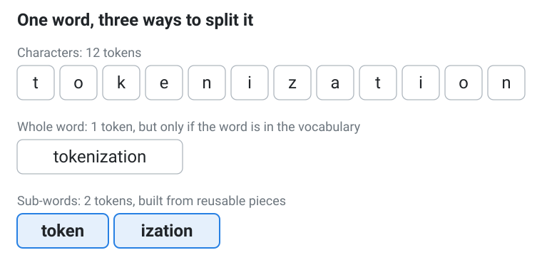
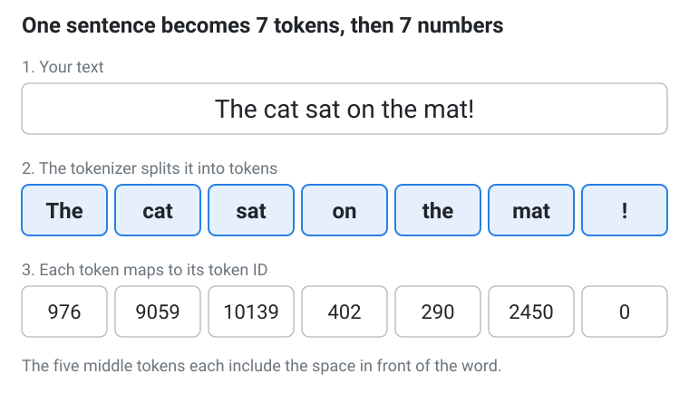
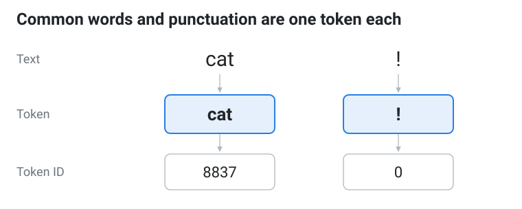
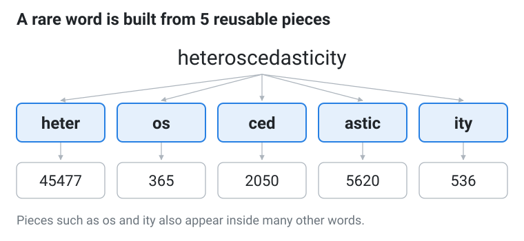

::: {.callout-tip .definition title="Definition"}
A token is the basic atomic unit that an LLM reads and writes. Before a model
sees your prompt, a tokenizer breaks the text into chunks and maps each chunk to
a number (its token ID), because models operate on numbers, not text. Tokens are
also the unit of measure for LLMs: context windows are sized in tokens, and usage
is priced by the number of input and output tokens.
:::

## More context

Every split and token ID on this page was produced by running OpenAI's
`o200k_base` tokenizer (the encoding used by the GPT-4o model family) on
2026-11-15. Other models will give different splits and IDs.

### Why tokens exist

Let's start with why we need tokens at all. A model is, at its core, a lot of
math, and math works on numbers. So before a model can do anything with your
text, that text has to be turned into a sequence of numbers. The question is how
big each piece of text should be. You have three options, and seeing why the
first two fall short tells you why nearly every modern LLM uses the third.

| Approach | Upside | Downside |
|---|---|---|
| One token per character | Tiny vocabulary. Can spell any word, name or typo, so nothing is ever unknown. | Very long sequences, which use up the context window and compute. A single letter carries almost no meaning. |
| One token per word | Short sequences. Every token carries meaning. | The vocabulary is enormous and never complete. New, rare or misspelled words have no token, and related words share nothing. |
| Sub-word pieces | Common words stay whole, so sequences stay short. Rare words are built from reusable parts, so nothing is unknown. | Splits are not always intuitive, and token counts are harder to predict. |

To see the trade-offs, let's run one word, "tokenization", through all three
approaches.

{fig-alt="The word tokenization split three ways: 12 character tokens, 1 whole-word token, or 2 sub-word tokens, token and ization."}

- **One token per character.** The appeal here is simplicity. The vocabulary is
  tiny, and you can spell any word, name or typo, so nothing is ever "unknown".
  The cost is length. Our one word becomes 12 tokens, and a whole document takes
  about four times as many tokens as it would with sub-words. That eats up the
  context window and adds compute. It also forces the model to work out what
  words mean from individual letters, which carry almost no meaning on their own.
- **One token per word.** This fixes the length problem. Our word is 1 token, and
  every token means something. But now the vocabulary is the problem. You'd need
  an entry for every word in every language, plus every variation ("token",
  "tokens", "tokenize", "tokenized"), every name and every piece of jargon, and
  you'd still miss things. Anything not on the list, like a new product name or a
  typo, becomes an "unknown" token, and the model loses that information
  entirely. The model also gets no hint that "tokenize" and "tokenization" are
  related, because to it they're just two unrelated IDs.
- **Sub-word pieces.** This is the middle ground. Our word becomes 2 tokens,
  "token" and "ization". Common words still get a single token, so sequences stay
  short. Rare words get built from smaller pieces, so nothing is ever unknown.
  And related words can share pieces, since that same "ization" piece can be
  reused in other words with the same ending. The price you pay is that the
  splits aren't always intuitive, which is where most of the surprises later on
  this page come from.

So why do we land on sub-words? Because it's the one approach that avoids both
failure modes. You get short sequences like the word approach, you can represent
any text like the character approach, and the vocabulary stays a manageable size.

So how does a tokenizer decide what gets its own token? It learns from a huge
body of text. Character sequences that show up all the time ("cat", "the", "ing")
earn their own token. Sequences that rarely appear get assembled from smaller
pieces that are already in the vocabulary. You end up with a fixed vocabulary,
typically somewhere between tens of thousands and a few hundred thousand tokens,
that can still represent any text you throw at it.

To put real numbers on that: the tokenizer behind GPT-4 has a vocabulary of
100,256 common tokens, and GPT-4o's (the `o200k_base` tokenizer used throughout
this page) nearly doubles that to about 200,000
([Yang et al., 2024](https://arxiv.org/pdf/2406.11214)).

### How text becomes tokens

Your text reaches the model in three steps. You write the text, the tokenizer
splits it into tokens, and each token gets swapped for its token ID. From that
point on, the model only ever works with the IDs.

{fig-alt="The sentence The cat sat on the mat! is split into 7 tokens, and each token maps to a token ID: 976, 9059, 10139, 402, 290, 2450, 0."}

Count them up. The sentence has 6 words and one punctuation mark, and it comes
out as 7 tokens. The same process runs in reverse when the model responds: it
produces token IDs one at a time, and the tokenizer turns them back into text you
can read.

### Simple example: one piece of text, one token

Let's start with the easy case. Short, common pieces of text map to exactly one
token. The word "cat" shows up so often in the text the tokenizer learned from
that it gets its own entry in the vocabulary. The exclamation mark does too.

{fig-alt="cat becomes one token with ID 8837, and ! becomes one token with ID 0."}

This is the version of a token that's easy to picture: one word or one character
goes in, and one number comes out. If every word worked this way, tokens and
words would be the same thing. They don't, which brings us to the next example.

### Complex example: one word, several tokens

Now take a long, rare word. The word "heteroscedasticity" is too uncommon to have
its own entry in the vocabulary, so the tokenizer builds it out of five smaller
pieces that it does know.

{fig-alt="heteroscedasticity splits into 5 tokens: heter, os, ced, astic, ity, with IDs 45477, 365, 2050, 5620, 536."}

So one 18-character word costs 5 tokens, while "cat" costs 1. Notice that the
pieces aren't always syllables or meaningful word parts. They're simply the
character sequences the tokenizer found most useful across all the text it
learned from. That said, you'll often find that common prefixes and suffixes get
their own token ID. This is the trick that lets a fixed vocabulary represent
words it has never seen before, including jargon, names and even typos.

### Why tokens matter in practice

Why should you care about any of this? Because every limit an LLM has, and every
bill an LLM provider sends, is written in tokens. Once you start thinking in
tokens, you can estimate whether a task will fit in the context window of the
model you're using and what it will cost.

- **Context window.** The most a model can consider at once is measured in
  tokens. Your prompt, any documents you attach, the conversation history and the
  model's reply all count against it.
- **Pricing.** API usage is billed per token, and you pay separate rates for
  input tokens (what you send) and output tokens (what the model generates).
  Output tokens usually cost more.
- **Speed.** A model writes its reply one token at a time, so a longer answer
  takes longer. That's why you'll see generation speed quoted in tokens per
  second.
- **Output limits.** The maximum length of a single reply is set in tokens too.

Here's a handy rule of thumb for English text: one token is about four
characters, or about three quarters of a word. So 1,000 tokens works out to
roughly 750 words. Treat it as an approximation, though. Technical vocabulary,
code and non-English languages usually use more tokens per word. For example,
Andrej Karpathy demonstrates the difference between English and Korean
tokenization in [this video](https://www.youtube.com/watch?v=zduSFxRajkE).

### Things that surprise people

Tokens don't line up with words, and small changes to your text can change the
tokens you get. Here are a few examples that tend to catch people off guard, all
from the same tokenizer used in the examples above.

| Text | Tokens | Split | What it shows |
|---|---|---|---|
| `cat` | 1 | `cat` | A common word is one token |
| `" cat"` (with a leading space) | 1 | `" cat"` | The space is part of the token, and it has a different ID than `cat` |
| `Cat` | 1 | `Cat` | Capitalization changes the token ID |
| `Heteroscedasticity` | 6 | `H` `eter` `os` `ced` `astic` `ity` | Capitalizing the word changed the split from 5 tokens to 6 |
| `strawberry` | 3 | `st` `raw` `berry` | Without a leading space, the word splits into pieces |
| `" strawberry"` (with a leading space) | 1 | `" strawberry"` | Mid-sentence, the same word is a single token |
| `12345.67` | 4 | `123` `45` `.` `67` | Numbers are split into groups of up to three digits |

Two more things worth remembering:

- **Tokenizers differ by model.** Each model's tokenizer has its own vocabulary,
  so the same text can split differently, and produce a different token count, on
  another model. To see this, paste text into
  [tiktokenizer](https://tiktokenizer.vercel.app/) and switch between models. For
  Claude models, which tiktokenizer doesn't cover, use Anthropic's
  [token counting API](https://platform.claude.com/docs/en/build-with-claude/token-counting#how-to-count-message-tokens).
- **The model never sees letters.** It sees token IDs. That's one reason LLMs can
  stumble on tasks that seem trivial to us, like counting the letters in a word or
  doing digit-by-digit arithmetic.

## Usage example

Let's make this concrete. Counting tokens takes only a few lines of Python: load
a tokenizer, encode the text, and take the length of the result. The script below
([`count.py`](https://github.com/bradleyboehmke/ai-engineering-notes/blob/main/learning/llm-mechanics/experiments/count.py))
does that for any mix of text and PDF files, and it also reports how each file
compares with the rule of thumb.

```python
import sys, tiktoken
from pypdf import PdfReader

enc = tiktoken.get_encoding("o200k_base")

def read_text(path):
    if path.endswith(".pdf"):
        return "\n".join(page.extract_text() for page in PdfReader(path).pages)
    return open(path, encoding="utf-8").read()

for path in sys.argv[1:]:
    text = read_text(path)
    n = len(enc.encode(text))
    print(f"{path}: {n} tokens, {len(text)/n:.1f} chars/token, "
          f"{len(text.split())/n:.2f} words/token")
```

There are only three pieces you need to understand:

- `tiktoken.get_encoding("o200k_base")` loads the tokenizer. It's the same
  encoding behind every example on this page.
- `read_text` turns each file into plain text. A PDF has to be extracted to text
  first, because a tokenizer only works on text.
- `enc.encode(text)` returns the list of token IDs. The length of that list is
  your token count.

Here's what you get when you run it on three sample files: a
[Markdown report](https://github.com/bradleyboehmke/ai-engineering-notes/blob/main/learning/llm-mechanics/experiments/samples/quarterly-update.md),
a [Python script](https://github.com/bradleyboehmke/ai-engineering-notes/blob/main/learning/llm-mechanics/experiments/samples/moving_average.py)
and a [PDF invoice](https://github.com/bradleyboehmke/ai-engineering-notes/blob/main/learning/llm-mechanics/experiments/samples/supplier-invoice.pdf).

```
$ python count.py quarterly-update.md moving_average.py supplier-invoice.pdf
quarterly-update.md: 245 tokens, 2.9 chars/token, 0.49 words/token
moving_average.py: 296 tokens, 3.7 chars/token, 0.50 words/token
supplier-invoice.pdf: 325 tokens, 2.7 chars/token, 0.39 words/token
```

Notice anything? All three files use more tokens than the rule of thumb predicts.
The rule says about 4 characters and 0.75 words per token. These files come in at
2.7 to 3.7 characters and 0.39 to 0.50 words per token, which means each word
costs two tokens or more. Here's why:

- **The Markdown report** is full of dollar amounts, percentages and table pipes,
  and numbers and symbols split into lots of small tokens.
- **The Python script** comes closest to the rule on characters. But operators,
  brackets and indentation all cost tokens without counting as words.
- **The PDF invoice** is the most expensive per word. Item codes like PKG-1001 and
  prices like $2,166.20 break into many pieces, and text extraction puts each
  table cell on its own line.

One caveat on the PDF: its count depends on how the text was extracted. Use a
different PDF library, or feed in a scanned PDF, and you can get a different
count for the same page.

To run this yourself, with the samples or your own files,
[open the notebook in Colab](https://colab.research.google.com/github/bradleyboehmke/ai-engineering-notes/blob/main/learning/llm-mechanics/experiments/count_tokens.ipynb).

## What to avoid

Most mistakes with tokens come from treating a token as something it isn't: a
word, a fixed size, or a universal unit. Here are the ones to watch for.

- **Treating tokens as words.** Token boundaries don't match word boundaries. One
  word can be several tokens, and a token can include a space or punctuation. So
  don't use a word count as a stand-in for a token count.
- **Assuming counts carry across models.** Each model family has its own
  tokenizer, so the same text will give you a different token count on a
  different model. Always count with the tokenizer for the model you'll actually
  call.
- **Trusting the rule of thumb for anything but plain prose.** "Four characters
  per token" is an estimate for ordinary English. As the usage example showed,
  numbers, code and tables can run at roughly twice the tokens per word.
- **Counting only your own prompt.** The system prompt, conversation history,
  attached documents and tool definitions all count as input tokens. A short
  question at the end of a long conversation is not a small request.
- **Forgetting output tokens.** The reply counts against the context window and
  shows up on the bill, usually at a higher rate than input. Leave room for it
  rather than filling the window with input.
- **Assuming a file's token count is fixed.** A tokenizer counts text, not files.
  For PDFs and other formatted documents, the count depends on how the text was
  extracted.
- **Expecting letter-level precision.** Remember, the model sees token IDs, not
  characters. That's why counting letters, reversing a string or exact digit
  arithmetic are weak spots.
- **Ignoring formatting.** Indentation, whitespace, Markdown table pipes and JSON
  punctuation all cost tokens. A verbose format costs more than a compact one for
  the same information.

## Related terms

Tokens are the entry point to a handful of neighboring concepts. These are the
ones worth learning next, and the ones to link from this entry in the dictionary.

- **Tokenizer.** The component that splits text into tokens and converts them to
  IDs, and converts IDs back into text.
- **Token ID.** The integer that stands for a token in the model's vocabulary.
- **Vocabulary.** The fixed list of every token a model knows.
- **Byte pair encoding (BPE).** A common algorithm for learning a sub-word
  vocabulary by repeatedly merging the most frequent pairs of characters.
- **Embedding.** The vector of numbers a model looks up for each token ID. This is
  where a token starts to carry meaning.
- **Context window.** The maximum number of tokens a model can consider at once.
- **Input and output tokens.** The two quantities that API usage is measured and
  billed in.
